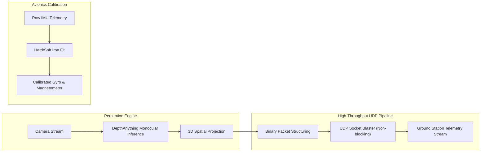

# Monocular 3D Depth Estimation, Sensor Fusion & Telemetry Pipeline

An integrated perception and telemetry suite designed for real-time aerial spatial mapping, fusing monocular depth estimation with high-rate UDP network streaming and IMU sensor calibration.

---

## Architecture Overview

---

## Core Components

### 1. Monocular 3D Depth Estimation (`DepthAnything - 3D.py`)
* Leverages deep monocular depth priors to infer relative and metric depth maps from single-camera aerial feeds without requiring heavy stereo rigs or LiDAR payloads.
* Generates continuous depth fields for real-time terrain contouring and obstacle clearance calculation.

### 2. High-Throughput UDP Streaming Pipeline (`01` through `08`)
* **`01_udp_blasting.py` & `02_udp_stream.py`**: Raw UDP datagram socket transmitters engineered for minimal latency over local 802.11 wireless links.
* **`03_coordinated_blasting.py` & `04_coordinated_stream.py`**: Timestamped synchronization layer ensuring frame order preservation across lossy transports.
* **`05_upscaled_blasting.py` through `08_upscaled2_stream.py`**: Multi-resolution streaming pipeline with dynamic buffer management to prevent frame tearing during telemetry bursts.

### 3. Sensor Fusion & IMU Calibration (`calibration.py`, `raw_sensor_plot.py`)
* **Magnetometer Calibration**: Corrects for hard-iron offsets (permanent magnetic fields on the airframe) and soft-iron distortions (induced eddy currents and structural interference) using 3D ellipsoid fitting.
* **Gyroscope Drift Compensation**: High-rate bias tracking to mitigate angular random walk in orientation estimates.
* **Visual Verification**: Output plots compare raw versus calibrated states:
  * `Calib Vs Gyro.png`: Gyroscopic rate bias nullification.
  * `Calib Vs Magnet.png`: Spherical normalization of magnetic field vectors.

---

## Empirical Verification Assets

* **`Calib Vs Gyro.png`**: Empirical plot showing zero-rate drift correction.
* **`Calib Vs Magnet.png`**: Multi-axis sphere fitting showing orthogonal distortion removal.
