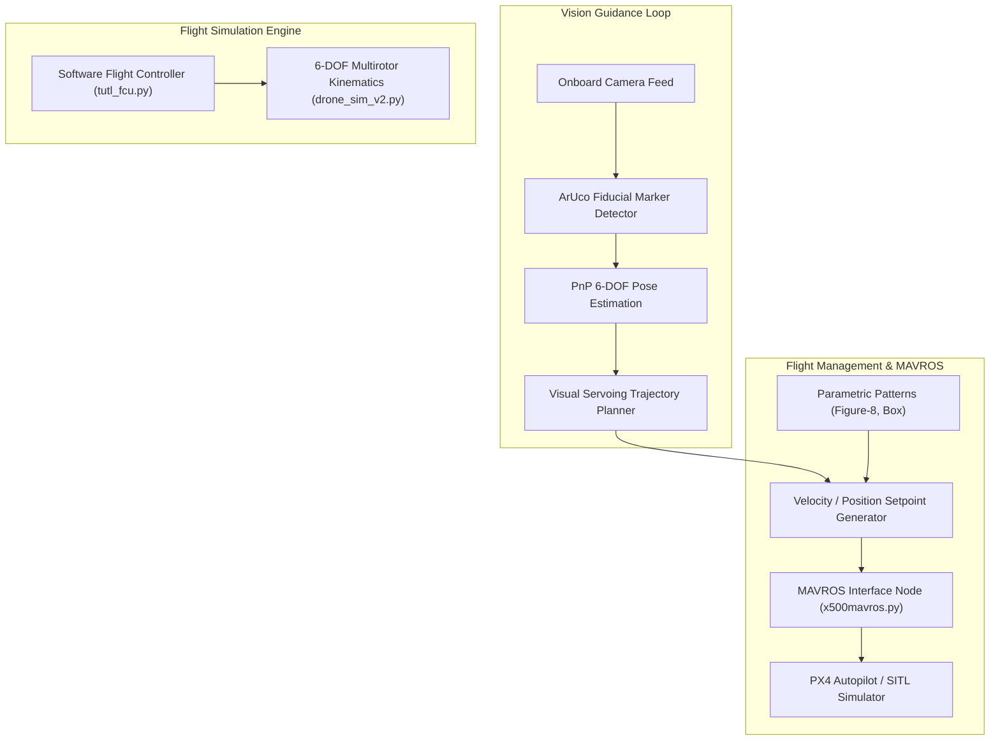

# Autonomous UAV Flight Dynamics, MAVROS Control & Vision-Guided Pursuit

A modular autonomous flight control suite featuring PX4 / MAVROS trajectory generation, visual servoing via ArUco marker tracking, and multirotor 6-DOF dynamic flight simulation.

---

## Architecture Overview

---

## Core Capabilities

### 1. Vision-Guided Autonomous Pursuit (`ArUco_Hunt.py`, `ArUco_Server.py`)
* Implements closed-loop visual servoing by solving the Perspective-n-Point (PnP) problem on detected ArUco dictionary markers in real time.
* Translates marker pixel displacement and estimated relative distance into body-frame velocity setpoints, allowing the quadcopter to acquire, track, and pursue moving targets dynamically.
* `ArUco_Server.py` acts as a centralized telemetry broker broadcasting target coordinates across the local network.

### 2. MAVROS Trajectory Generation (`x500mavros.py`, `x500_test_*`)
* Interfaces directly with PX4 autopilots over ROS / MAVROS message bridges (`/mavros/setpoint_position/local`, `/mavros/state`).
* Automated flight routines:
  * **Precision Hover (`x500_test_hover.py`)**: Closed-loop altitude and position hold with arming and offboard mode transitions.
  * **Box Survey (`x500_test_box.py`)**: Perimeter waypoint navigation with yaw heading orientation at each waypoint vertex.
  * **Parametric Figure-8 (`x500_test_fig8.py`)**: Continuous Lissajous / lemniscate curve trajectory execution requiring smooth acceleration and coordinated turn control.

### 3. Multirotor Dynamics & Software FCU (`drone_sim_v2.py`, `tutl_fcu.py`)
* **Dynamic Simulator**: Simulates 6-DOF rigid body kinematics, quadcopter motor thrust curves, rotational inertia, gravity, and aerodynamic drag.
* **Flight Controller Unit (`tutl_fcu.py`)**: Implements cascaded PID feedback architecture:
  * Outer loop: Position to desired velocity and tilt angle translation.
  * Inner loop: Attitude angles (Roll, Pitch, Yaw) to commanded body rate torques.
