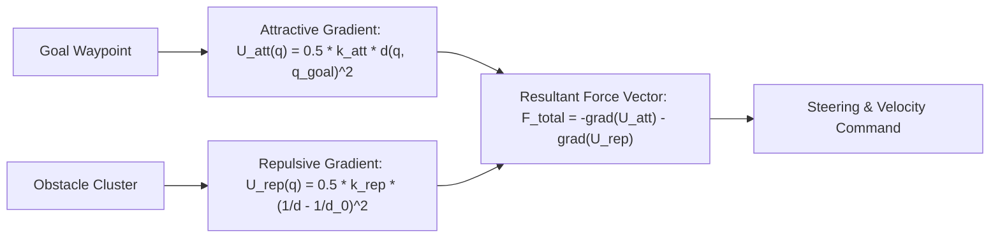

# Artificial Potential Field (APF) & Multi-Mode Reactive Pathfinding

Real-time reactive navigation and collision avoidance algorithms for autonomous vehicles, implementing gradient-descent Artificial Potential Fields (APF) and multi-mode trajectory planning.

---

## Navigation Mechanics

---

## Core Implementations

### 1. Artificial Potential Field Navigation (`potential_field.py`)
* Computes an artificial energy landscape across continuous 2D space:
  * **Attractive Field**: Quadratically pulls the vehicle toward the target destination, ensuring zero error at convergence.
  * **Repulsive Field**: Hyperbolic barrier functions surrounding detected obstacles, activating only within a defined perimeter ($d_0$) to maintain computational efficiency.
* Resultant force vectors determine instantaneous heading and velocity, enabling smooth, continuous obstacle avoidance without expensive global graph recomputations.
* Includes local minimum detection heuristics to prevent the agent from getting trapped in concave obstacle formations.

### 2. Multi-Mode Pathfinding Suite (`path_finding_5-mode.py`)
* A comparative algorithmic testbed evaluating five discrete navigation strategies:
  1. Direct Vector Pursuit
  2. Pure Artificial Potential Fields
  3. Discrete Grid Search (A*)
  4. Hybrid APF with Waypoint Checkpoints
  5. Dynamic Velocity Obstacle (DVO) Reactive Avoidance
* Outputs path length, convergence time, clearance metrics, and smooth curvature profiles.
