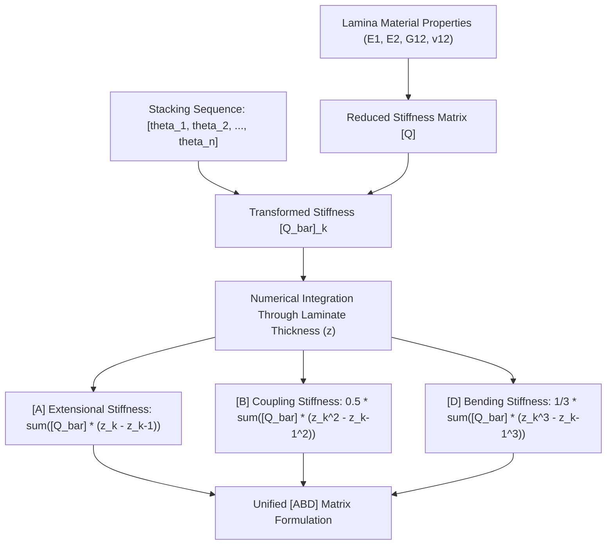

# Computational Aerostructures: Classical Lamination Theory & Tsai-Wu Failure Analysis

A numerical mechanics suite for advanced composite aerostructures, implementing Classical Lamination Plate Theory (CLT), $[ABD]$ stiffness tensor derivation, and Tsai-Wu quadratic failure envelope analysis.

---

## Classical Lamination Theory Formulation

---

## Core Implementations

### 1. Unified $[ABD]$ Stiffness Calculator (`ABD.py`, `Composite_Stack_v5.py`)
* Computes the complete 6x6 constitutive relation connecting in-plane forces $[N]$ and moments $[M]$ to mid-plane strains $[\epsilon^0]$ and curvatures $[\kappa]$:
  $$\begin{bmatrix} N \\ M \end{bmatrix} = \begin{bmatrix} A & B \\ B & D \end{bmatrix} \begin{bmatrix} \epsilon^0 \\ \kappa \end{bmatrix}$$
* Evaluates arbitrary multi-angle ply schedules (e.g. Quasi-Isotropic $[90/45/-45/0]_{3s}$, angle-ply, and cross-ply configurations).
* Handles symmetric and anti-symmetric coupling effects, confirming when $[B] = 0$ to decouple membrane forces from bending deformations.

### 2. Tsai-Wu Quadratic Failure Criterion (`Tsai-Wu.py`)
* Evaluates failure boundaries under multi-axial stress states ($\sigma_1, \sigma_2, \tau_{12}$) using the tensor polynomial criterion:
  $$F_1 \sigma_1 + F_2 \sigma_2 + F_{11} \sigma_1^2 + F_{22} \sigma_2^2 + F_{66} \tau_{12}^2 + 2 F_{12} \sigma_1 \sigma_2 = 1$$
* Incorporates unequal tensile and compressive yield strengths ($X_t, X_c, Y_t, Y_c, S$) to compute failure indices across individual laminate plies.
* Generates continuous ellipsoidal failure envelopes to identify safe operational loading envelopes for high-performance aerospace components.

### 3. Structural Standards & Orthotropy Validation (`esdupac.py`, `LAMINATEABD.py`)
* Algorithmic verification conforming to ESDU (Engineering Sciences Data Unit) standards for aerospace laminate analysis.
* Automatically tests whether a given stack configuration satisfies the mathematical criteria for special orthotropy, uncoupling extension from shear and bending from twisting.
