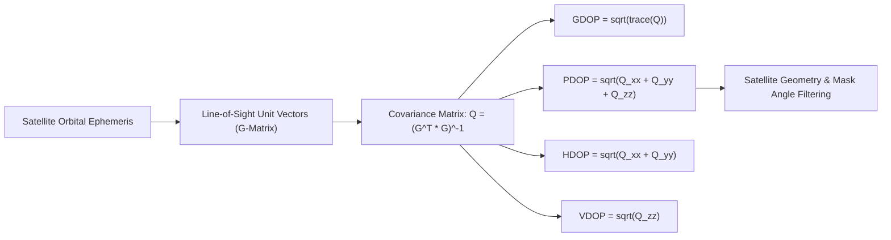

# Geospatial Satellite Telemetry & GNSS Dilution of Precision (PDOP) Analysis

A numerical analysis pipeline modeling satellite orbital geometry, Dilution of Precision (DOP), and ground-station positioning errors for global navigation satellite systems (GNSS).

---

## Analytical Overview

---

## Key Technical Focus

### 1. Dilution of Precision (DOP) Modeling
* Derives the geometric error amplification factor between satellite pseudo-range measurements and receiver positional uncertainty.
* Implements mathematical decomposition of the design matrix $[G]$:
  * **PDOP (Position Dilution of Precision)**: 3D spatial coordinate accuracy.
  * **HDOP (Horizontal Dilution of Precision)**: In-plane ground position variance.
  * **VDOP (Vertical Dilution of Precision)**: Geometric vertical error inflation due to one-sided satellite constellation visibility.

### 2. Empirical Ground Survey Analysis (`GNSS_Survey_PDOP_Analysis.ipynb`)
* Evaluates empirical field data (`Project 1_pot_corners.csv`) recorded under varying sky obstructions.
* Analyzes the correlation between elevation mask thresholds, visible space vehicle (SV) count, and position variance.
* Produces distribution histograms, temporal PDOP degradation plots, and spatial error ellipses.
