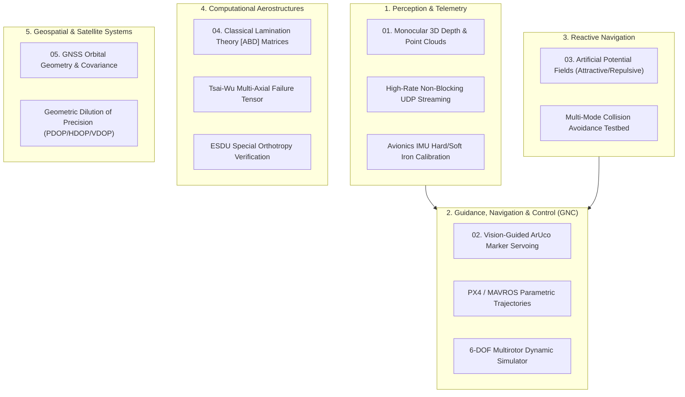

# Aerospace, Autonomous Systems & Applied Computing Portfolio

[](https://www.python.org/)
[](https://px4.io/)
[](https://opencv.org/)
[](#04-computational-aerostructures)
[](LICENSE)

An engineering portfolio showcasing applied algorithms, numerical modeling, and autonomous robotics systems across aeronautical computing, monocular computer vision, multirotor flight dynamics, and structural mechanics.

Developed and maintained by **MinThirt-Ti**.

---

## Architectural Taxonomy



---

## Portfolio Showcase Modules

| Module Directory | Primary Technical Domain | Core Algorithms & Systems | Key Highlights |
| :--- | :--- | :--- | :--- |
| **[`01-computer-vision-and-3d-depth`](./01-computer-vision-and-3d-depth)** | Monocular 3D Perception & Telemetry | DepthAnything, 3D Point Clouds, UDP Sockets | Monocular depth inferencing paired with non-blocking UDP stream pipelines (stages 01 to 08) and IMU ellipsoid calibration. |
| **[`02-autonomous-uav-flight-and-tracking`](./02-autonomous-uav-flight-and-tracking)** | Autonomous Flight & Visual Servoing | PnP Solver, ArUco Pursuit, MAVROS, PX4 | Closed-loop visual target tracking, parametric Figure-8 and Box survey flight routines, and 6-DOF multirotor dynamic physics. |
| **[`03-artificial-potential-field-nav`](./03-artificial-potential-field-nav)** | Reactive Obstacle Avoidance | Gradient Descent APF, Harmonic Repulsion | Real-time continuous obstacle avoidance utilizing attractive target vectors and hyperbolic barrier repulsion functions. |
| **[`04-computational-aerostructures`](./04-computational-aerostructures)** | Composite Mechanics & Failure Criteria | Classical Lamination Theory, Tsai-Wu Tensor | Closed-form $[ABD]$ stiffness derivation for 24-ply laminate schedules with multi-axial Tsai-Wu quadratic failure envelopes. |
| **[`05-geospatial-satellite-telemetry`](./05-geospatial-satellite-telemetry)** | Satellite Navigation & Orbit Geometry | Line-of-Sight Covariance, PDOP / GDOP | Quantitative Dilution of Precision modeling analyzing satellite geometry, elevation angle masks, and positioning variance. |

---

## Engineering Competencies Demonstrated

* **Autonomous Flight & Robotics**: MAVROS messaging bridges, PX4 offboard trajectory control, cascaded PID attitude control, and visual servoing.
* **Computer Vision & Perception**: Perspective-n-Point pose estimation, ArUco fiducial marker tracking, monocular depth field estimation, and color-space tracking.
* **Network & Telemetry Architecture**: Non-blocking UDP datagram broadcasting, timestamp synchronization, and multi-resolution video frame packing.
* **Theoretical Aerostructures & Mechanics**: Constitutive $[ABD]$ laminate tensor integration, ply-by-ply stress-strain transformation, and Tsai-Wu failure criteria.
* **Numerical Scientific Computing**: NumPy tensor operations, SciPy optimization, Matplotlib parametric visualizations, and ellipsoid fitting.

---

## Setup & Verification

All modules operate with Python standard library and common scientific computing libraries:

```bash
# Clone the repository
git clone https://github.com/MinThirt-Ti/aerospace-autonomous-systems.git
cd aerospace-autonomous-systems

# Install common scientific dependencies
pip install numpy matplotlib scipy opencv-python
```

Each subdirectory contains its own standalone technical documentation and executable entry points.
